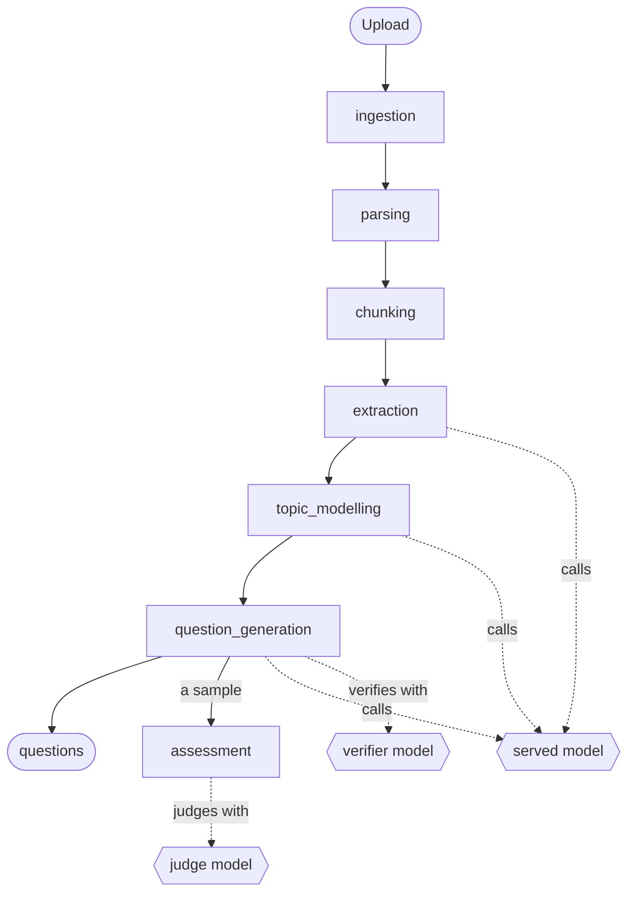
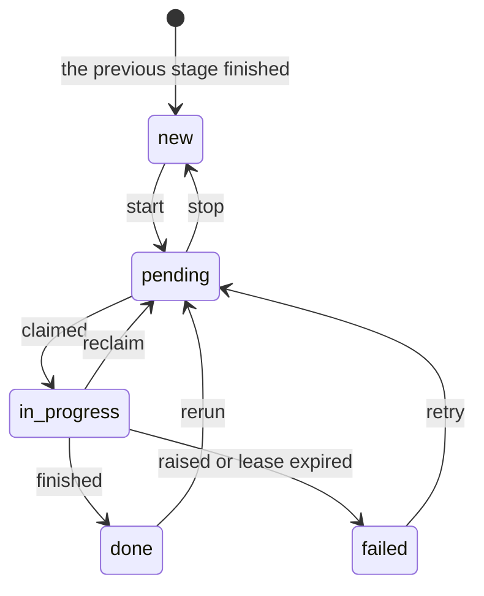
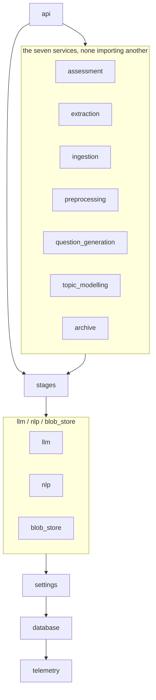
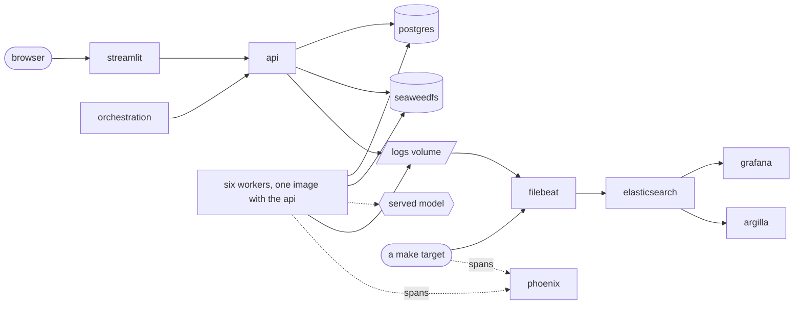

# Architecture

Four graphs show what a document becomes, what a worker does with a row,
what a module may import, and what runs in a container.

## 1. What a document becomes

Six packages process a document in order, each reading the previous one's
tables. Ingestion has no queue: an upload writes a row and an object. A
seventh, `assessment`, runs last and feeds no stage.



| Stage | Claims | Writes | Done value |
|---|---|---|---|
| `parsing` | `documents.parse_status` | parsed document, `parsed` bucket | `parsed` |
| `chunking` | `documents.chunk_status` | `passages` | `chunked` |
| `extraction` | `passages.extract_status` | `facts`, `fact_passages` | `extracted` |
| `topic_modelling` | `topics.status` | `topics`, `passage_topics` | `modelled` |
| `question_generation` | `topics.question_status` | `questions`, `question_facts` | `generated` |
| `assessment` | `assessments.assess_status` | `assessments`, `assessment_metrics` | `assessed` |

A stage claims on its own status column only. Chunking reads `parse_status`
in `start` and `rerun` alone, to queue finished documents.

`start` on assessment enrols the newest `ASSESSMENT_SAMPLE` rows of each kind
in `ASSESSMENT_KINDS` and queues them. Unanswerable questions are never
enrolled. `ASSESSMENT_ENABLED` switches the stage off; the dataset does not
depend on it.

The five buckets (`S3_BUCKETS` in `configs/env/deployment.env`) are
`documents`, `parsed`, `models`, `export` and `archive`. See
[`backend/blob_store/`](../backend/blob_store/README.md).

## 2. What a worker does with one row

All six stages share one queue, written once in
[`backend/stages/`](../backend/stages/README.md).



Only `pending` rows are claimed. The Start button, a route, a
`make ...-start` or the [orchestrator](../orchestration/README.md) queues it.

A claim is `SELECT ... FOR UPDATE SKIP LOCKED`, one row at a time. Extraction
runs at most two drains, the number its duplicate lock was measured with
([Scaling](operations.md#scaling)):

```bash
export COMPOSE_ENV_FILES=configs/env/deployment.env,.env
podman compose up -d --scale extract-worker=2
```

The worker holding a claim refreshes its timestamp every
`HEARTBEAT_SECONDS`. The next run of the stage fails a row whose worker died,
and `retry` returns it. `reclaim` returns it without waiting for the lease.

## 3. What a module may import

[`.importlinter`](../.importlinter) enforces the layers: run
`make lint-imports`. A layer imports only lower layers.



| Contract | Says |
|---|---|
| `layers` | A stage sits above what it shares and below nothing but the api |
| `stages-are-independent` | No backend service imports another |

Two edges are allowed on purpose. `settings.changes` imports `llm.config` and
every stage's `config` submodule, to call that service's own `Settings.load`.
`question_generation.export` imports `assessment.repository` inside one
function body.

`backend/confidence.py` is a leaf outside the graph. Extraction, question
generation and `stages.recalibrate` import it. It imports only the standard
library, and nothing enforces that.

A service package re-exports nothing, so a caller loads only the submodule it
names. The contracts cannot check this;
[`tests/static/test_api_stays_light.py`](../tests/static/test_api_stays_light.py)
does.

## 4. What runs in a container



The frontend talks only to the api. The served model is the one outbound
call.

### The same stage, run on the host

`make extract`, `make topics` and `make questions` run the same code in a
host process against the same database. Each refuses to start while that
stage's container worker runs, and prints the command that stops it.

Containers call `LLM_CONTAINER_MODEL`. The host calls `LLM_MODEL`.

The container workers build the dataset. A host drain writes the same
tables, and only `RUN_ID`, when set, tells its rows apart. Do not build the
dataset with one. To compare two models, run them over the same rows under two
`RUN_ID`s.

## 5. Where the signals go

| Signal | Path | Read with |
|---|---|---|
| Logs | process, `logs` volume or `./logs` (JSON, ECS fields), Filebeat, Elasticsearch | Grafana, `make logs` |
| Traces | OTLP to Phoenix: a project per `<position>-<stage>`, and `<position>-<stage>-<RUN_ID>` for a named run | Phoenix |
| Cost and tokens | the span and the log line | Phoenix, `make spend LOG=` |
| Gate verdicts | the Postgres row (`questions.gates_ran` lists the gates run), a span attribute, one annotation per gate | the Questions page, `GET /lineage/question/<id>`, Phoenix |
| Lineage | `fact_passages`, `question_facts`, `passage_topics` | `GET /lineage/<kind>/<id>`, the **How this was produced** fold |
| Prompts | the `prompts` table, Phoenix | the Questions page, `GET /prompts`, Phoenix |
| Scores | golden cases run against the served model | `make eval-score`, Phoenix |
| Human review | a disposable copy in Argilla, the answers written back | Argilla, `make review-*` |

Every artefact table holds `trace_id` and `span_id`, and its page links to
both. See [`telemetry/`](../telemetry/README.md).

[`telemetry/pipeline.py`](../telemetry/pipeline.py) lists the seven stages.
The number before a name is the stage's place in that list, so `4-extraction`
in Phoenix, `4-facts` in Argilla and `stage_4_extraction` in Dagster are one
stage. `tests/static/test_tool_names.py` keeps the names equal.

Logs are deleted only by `make logs-retention` and `make logs-prune`.

## 6. Where to change things

| To change | Go to |
|---|---|
| Any behaviour setting | [`backend/settings/catalog.py`](../backend/settings/catalog.py) |
| Which model, or which provider | `LLM_MODEL` in `.env` (host), `LLM_CONTAINER_MODEL` (containers), `QUESTIONS_VERIFIER_MODEL` and `ASSESSMENT_JUDGE_MODEL`. A stage's own model (`EXTRACTION_MODEL`, `EXTRACTION_DIGEST_MODEL`, `TOPIC_MODEL`, `QUESTIONS_MODEL`, `QUESTIONS_PHRASING_MODEL`) is set in `configs/env/backend.env`. The shipped digest, topic-naming and phrasing models ignore `LLM_MODEL`. Credentials: `configs/env/provider.env` |
| Secrets | `.env` |
| Ports, addresses, role names | `configs/env/deployment.env` |
| Default pipeline behaviour | `configs/env/backend.env` |

See [configuration.md](configuration.md).

## What keeps this page true

`make lint-imports` checks the layers. `tests/static/test_architecture.py`
checks that this page names them, and `test_doc_links.py` checks its links.
